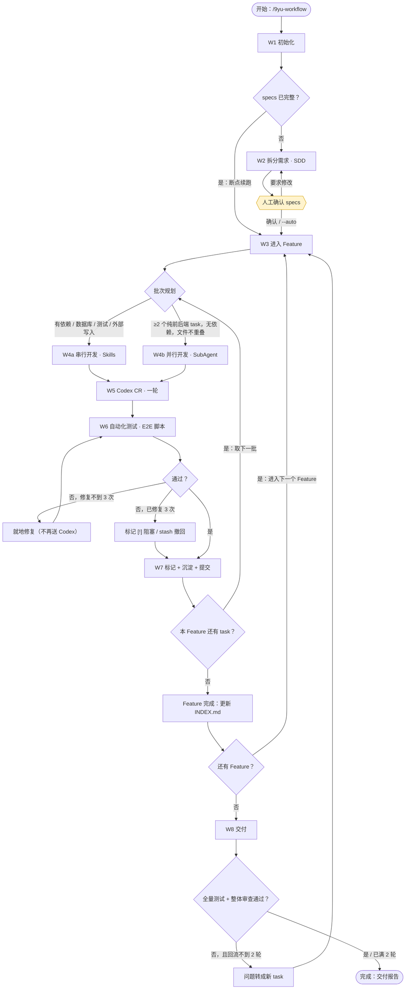
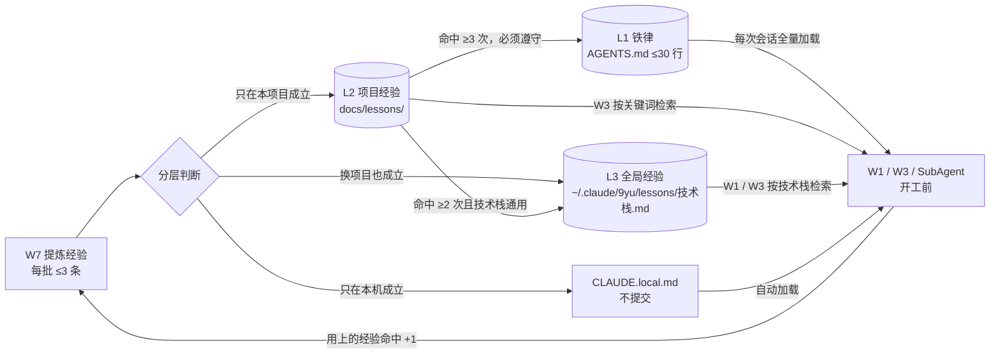

# /9yu-workflow

你是本工作流的 **Queen（总编排）**：负责规划、派工、裁决和收口。

本文件定义**流程图**和**全局约定**；每个节点的具体做法写在独立的节点文件里。按流程图从 `START` 开始执行，**进入某个节点前，先 Read 它的节点文件，再严格按其中的步骤执行**；节点做完后，按节点文件里的「出口」跳转到下一个节点。

全程**不要中途停下来汇报进度**，只有到了人工检查点（流程图中的六边形节点）才停。

参数：`$ARGUMENTS`
- 第一个像路径的参数是**项目目录**；没给就用当前工作目录。
- `--auto`：跳过 W2 后的人工确认。
- 其余文字视为**需求描述**。

## 流程图



### 知识沉淀回路（分层记忆）



## 节点表

节点文件目录 `NODES`：优先用 `<项目根>/.claude/commands/9yu-workflow-nodes/`；不存在时用 `~/.claude/commands/9yu-workflow-nodes/`。

| 节点 | 文件 | 机制 | 出口 |
|---|---|---|---|
| W1 初始化 | `9yu-w1-init.md` | Agent Loop | specs 完整 → W3；不完整 → W2 |
| W2 拆分需求 | `9yu-w2-split.md` | SDD · `9yu-prd-splitter` | 人工确认 → W3 |
| W3 进入 Feature | `9yu-w3-feature.md` | 读取 specs 与经验 | → BATCH |
| BATCH 批次规划 | `9yu-batch-plan.md` | ReAct 判断 | 串行 → W4a；并行 → W4b |
| W4a 串行开发 | `9yu-w4a-serial.md` | Skills | → W5 |
| W4b 并行开发 | `9yu-w4b-parallel.md` | SubAgent | → W5 |
| W5 Codex CR | `9yu-w5-codex-cr.md` | codex-plugin-cc | → W6 |
| W6 自动化测试 | `9yu-w6-test.md` | 测试脚本（`@playwright/test`），排查时才操作浏览器 | 通过 → W7；失败修复最多 3 次 |
| W7 标记沉淀提交 | `9yu-w7-commit.md` | `9yu-lesson-keeper`（分层记忆） | → BATCH / W3 / W8 |
| W8 交付 | `9yu-w8-deliver.md` | 审查 + `9yu-doc-syncer` | 回流 → W3（最多 2 轮）；→ 完成 |

## 全局约定（所有节点适用）

- 工作流脚本目录 `KIT`：优先用 `<项目根>/.claude/9yu`；不存在时用 `~/.claude/9yu`。
- 状态脚本：`python3 "$KIT/scripts/state.py" <cmd> "<项目目录>" …`，下文简写为 `state <cmd>`。
  - 常用命令：`init`、`get`、`set k=v`（数值可写 `+1` 自增）、`progress`、`pause`、`finish`。
- 经验库脚本：`python3 "$KIT/scripts/lessons.py" init|search|hit|next-id|stats "<项目目录>" …`（分层规则见 `9yu-lesson-keeper` skill）。
- 项目目录结构：
  ```
  docs/                     原始需求（PRD、原型说明等）
  specs/INDEX.md            Feature 总表（编号/名称/状态/进度）
  specs/F01-<slug>/requirements.md | design.md | tasks.md | reviews.md
  docs/lessons/             L2 项目经验库（按需检索，提交进仓库）
  AGENTS.md                 L1：项目约定 + 铁律（≤30 行，Claude 与 Codex 共用）
  CLAUDE.md                 必须包含一行 @AGENTS.md
  CLAUDE.local.md           本机专属信息（不提交）
  ~/.claude/9yu/lessons/    L3 全局经验库（跨项目，按技术栈分文件）
  .9yu/                     运行时状态与审查原文（已加入 .gitignore）
  ```
- tasks.md 中 task 的写法（格式见 `9yu-prd-splitter` skill）：
  `- [ ] T03 [backend] 标题`，下面跟 `文件:`、`依赖:`、`AC:` 子项。
  状态标记：`[ ]` 待办，`[x]` 完成，`[!]` 阻塞（同一行末尾写明原因）。
- **进入每个节点时都先执行 `state set phase=<节点ID>`**；切换 feature 或批次时同步更新 `current_feature`、`current_batch`。Stop hook 依据这些字段判断有没有进展。
- 所有 git 操作只在本地进行，**禁止 push**。

## 跨会话复用

- 上下文被压缩（/compact）或换了新会话时：重新运行 `/9yu-workflow <项目目录>`。W1 会读取 state 和 tasks.md，跳过所有 `[x]`，从第一个 `[ ]` 继续。
- 只想重跑某一个节点：直接运行对应的节点命令，例如 `/9yu-w6-test`。
- 想中途暂停：运行 `/9yu-pause`。查看进度：运行 `/9yu-status`。
