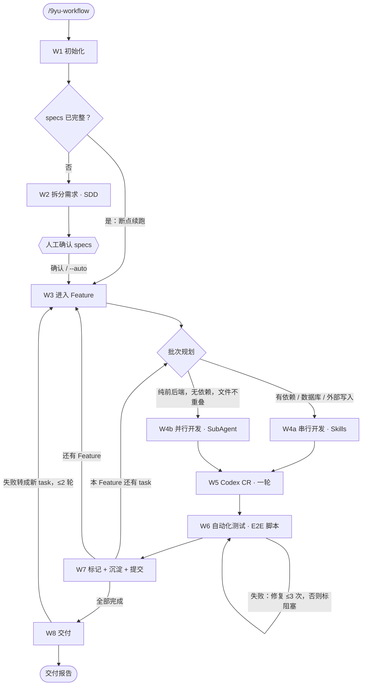

# 9yu-workflow

9yu-workflow 是一套 Claude Code 的斜杠命令工作流，覆盖从需求到交付的全过程：

- **规格驱动（SDD）**：先把需求拆成规格文件和任务清单；
- **持续推进（Agent Loop）**：按批次自动开发，中途不停下；
- **Codex 代码审查**：通过 [codex-plugin-cc](https://github.com/openai/codex-plugin-cc) 进行；
- **E2E 测试**：用 `@playwright/test` 写测试脚本验证；
- **分层永久记忆**：开发中积累的经验分层保存，下次开工时检索使用。

## 流程



完整流程图和每个节点的说明见 [.claude/commands/9yu-workflow.md](.claude/commands/9yu-workflow.md)。

## 环境要求

- [Claude Code](https://claude.com/claude-code)
- Python 3：用于状态管理和 Stop 钩子
- Node.js 18.18 或更高：用于 Codex 插件和 Playwright
- Codex 审查（可选，没有时由 `9yu-reviewer` 子代理兜底）：
  ```bash
  claude plugin marketplace add openai/codex-plugin-cc
  claude plugin install codex@openai-codex
  # 在 Claude Code 中运行 /codex:setup，确认 codex CLI 已安装并登录
  ```

## 使用

### 方式一：在本仓库里直接开发

```bash
git clone https://github.com/ninefish051/9yu-workflow.git my-project
cd my-project && claude
```

然后在 Claude Code 中运行：

```
/9yu-workflow 你的需求描述
```

### 方式二：复制到已有项目

把 `.claude/` 和 `.mcp.json` 复制到你的项目根目录即可。

### 命令

| 命令 | 作用 |
|---|---|
| `/9yu-workflow [项目目录] [--auto] [需求描述]` | 启动工作流，或从断点续跑；`--auto` 跳过拆完需求后的人工确认 |
| `/9yu-status` | 查看进度 |
| `/9yu-pause` | 暂停 |
| `/9yu-w1-init` … `/9yu-w8-deliver` | 单独重跑某个节点 |

## 目录结构

```
.mcp.json                          Playwright MCP（默认不启用，排查问题时用 /mcp 开启）
.claude/
├── commands/
│   ├── 9yu-workflow.md            主命令：流程图 + 节点表 + 全局约定
│   ├── 9yu-workflow-nodes/        10 个节点（W1–W8 + 批次规划）
│   ├── 9yu-status.md
│   └── 9yu-pause.md
├── skills/                        需求拆分、前端/后端/数据工程规范、经验沉淀、文档同步
├── agents/                        前端/后端并行开发子代理、兜底审查子代理
├── 9yu/scripts/                   state.py · stop_guard.py · lessons.py · codex_review.sh · precommit_secret_scan.sh
└── settings.json                  Stop 钩子：任务没做完时不让 Claude 中途停下
```

## 设计要点

- **断点续跑**：进度以 `specs/*/tasks.md` 中的勾选状态为准，运行状态保存在 `.9yu/state.json`。上下文被压缩或换了会话后，重新运行 `/9yu-workflow` 即可接着跑。
- **防止空转**：Stop 钩子只绑定启动工作流的那个会话。以下情况会放行：到了人工确认点、已暂停、已完成，或者连续 3 次没有进展（此时自动暂停）。
- **有限重试**：W6 测试修复最多 3 次，W8 回流最多 2 轮。超过上限就标记阻塞，或者写进交付报告的遗留问题，不会无限循环。
- **分层记忆**：
  - L1 `AGENTS.md`：项目约定和铁律，不超过 30 行；
  - L2 `docs/lessons/`：项目经验库；
  - L3 `~/.claude/9yu/lessons/`：跨项目经验库，按技术栈分文件。
  
  经验按命中次数晋升，按需检索，不会全量塞进上下文。
- **只在本地提交**：工作流全程不会 push。

迁移到全局 `~/.claude/` 的步骤见 [.claude/9yu/README.md](.claude/9yu/README.md)。
